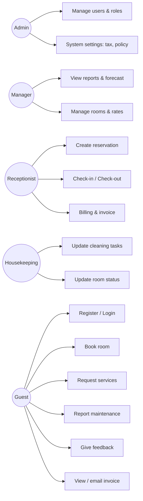
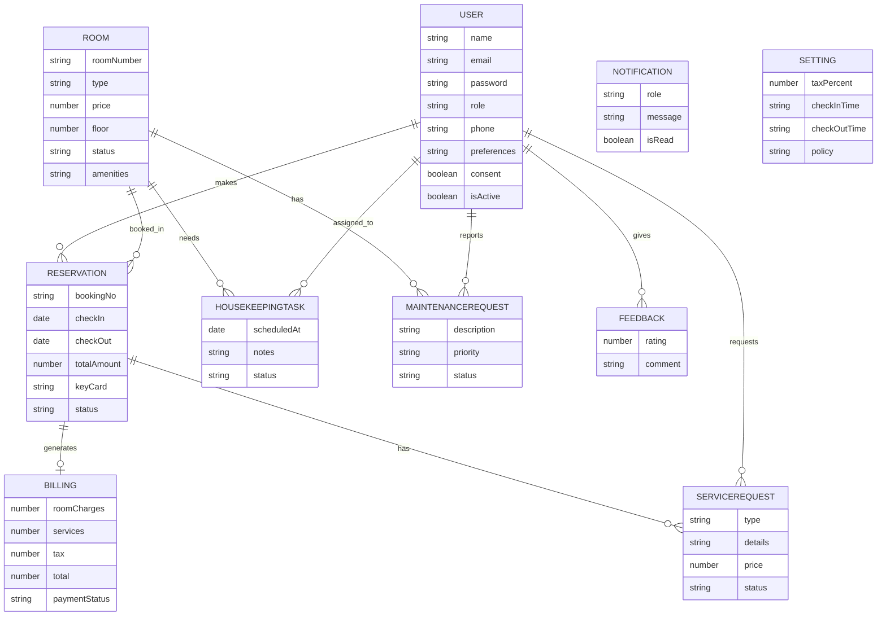

# LuxuryStay Hotel Management System - Project Documentation

## 1. Introduction
LuxuryStay Hospitality ke liye MERN (MongoDB, Express, React, Node.js) par bana Hotel Management System. Yeh bookings, rooms, billing, housekeeping, maintenance, guest services, feedback aur reports ko ek jagah manage karta hai.

## 2. Objectives
- Hotel ke daily operations ko automate karna
- Guest experience behtar banana (online booking, services, feedback)
- Management ko reports aur forecast dena
- Secure, role-based aur scalable system dena

## 3. Technology Stack
| Layer | Technology |
|---|---|
| Database | MongoDB (Atlas) + Mongoose |
| Backend | Node.js, Express |
| Frontend | React (Vite), React Router, Recharts, Axios |
| Security | JWT, bcrypt, helmet, CORS, express-rate-limit |
| Email | Nodemailer (optional SMTP) |

## 4. User Roles & Permissions
| Feature | Admin | Manager | Receptionist | Housekeeping | Guest |
|---|---|---|---|---|---|
| Users / Staff management | Full | View | View | - | - |
| Rooms | Full | Full | Add/Edit | Status update | View |
| Reservations | Full | Full | Full | - | Own only |
| Check-in / Check-out | Yes | Yes | Yes | - | - |
| Billing / Invoice | Full | Full | Full | - | Own only |
| Housekeeping tasks | Full | Full | Full | Update | - |
| Maintenance requests | Full | Full | Full | Update | Report (own) |
| Services | Full | Full | Full | - | Request (own) |
| Feedback | View/Delete | View/Delete | View | - | Submit |
| Reports & Forecast | Yes | Yes | - | - | - |
| System Settings | Yes | - | - | - | - |
| Notifications | All | Own role | Own role | Own role | - |

## 5. Use-Case Diagram


## 6. ERD (Entity Relationship Diagram)


## 7. Business Flow
1. Guest register karta hai (consent ke saath) -> room search -> booking -> **Booking No** milta hai.
2. Receptionist **check-in** karta hai -> room "occupied", **key card** issue hota hai.
3. Guest stay ke dauran services mangta hai; staff price aur status set karta hai.
4. **Check-out** par room "cleaning" mein jata hai, **bill khud banta hai** (room + services + tax), housekeeping task ban jata hai.
5. Housekeeping task "completed" karta hai -> room wapas "available".
6. Maintenance issue aaye to room "maintenance" mein; resolve hone par "available".

## 8. Installation / Developer Guide
```
# Backend
cd server
cp .env.example .env     # values bhar lein
npm install
npm run seed             # sirf admin banata hai
npm start                # http://localhost:5000

# Frontend
cd client
npm install
npm run dev              # http://localhost:5173
```
**Backend files:** server.js (entry), models/index.js (schemas), middleware/auth.js (protect, allow), routes/ mein har resource ki alag file: auth, users, rooms, reservations, billing, services, housekeeping, maintenance, feedback, notifications, reports, settings.
**Frontend files:** App.jsx (routes + menu), Crud.jsx (reusable table/form), pages/* (Login, Dashboard, Bookings, Billing, Settings, Profile, Notifications), auth.jsx, api.js.

### API Summary
| Endpoint | Purpose |
|---|---|
| POST /api/auth/register, /login; GET /me; PUT /profile | Authentication & profile |
| /api/users | Staff/guest management (admin) |
| /api/rooms | Room CRUD & status |
| GET /api/reservations/available | Available rooms by date |
| /api/reservations (+ /:id/checkin, /checkout, /cancel) | Booking lifecycle |
| GET /api/billing, PUT /billing/:id/pay, POST /billing/:id/email | Billing & invoice |
| /api/services, /api/housekeeping, /api/maintenance, /api/feedback, /api/notifications | Operations |
| GET /api/reports | Occupancy, revenue, forecast |
| GET/PUT /api/settings | System settings |

## 9. Non-Functional Requirements Mapping
| Requirement | How it is met |
|---|---|
| Performance (1-2 sec) | Lightweight REST API, indexed unique fields, MongoDB queries |
| Scalability | Stateless JWT backend -> horizontal scaling behind load balancer; MongoDB Atlas scales |
| Security | bcrypt hashing, JWT, role-based middleware, helmet, CORS, rate limiting, HTTPS in production |
| Privacy / GDPR | Registration par explicit consent (consentAt saved), password kabhi return nahi hota, accounts delete ke bajaye deactivate |
| Reliability / Backup | MongoDB Atlas automated backups / snapshots; deployment par monitoring |
| Usability | Responsive UI, consistent navigation, status badges |
| Compatibility | Chrome, Firefox, Safari, Edge; mobile responsive layout |
| Logging | morgan request logs (console) |
| Documentation | Yeh document + README + code comments |

## 10. User Guide
**Guest:** Register (consent tick) -> Login -> *Bookings*: dates chuno, *Check Availability*, *Book* -> confirmation card (Booking No). *Services*: booking select karke service mangein. *Maintenance*: masla report karein. *Feedback*: rating dein. *Billing*: invoice dekhein / print / email. *My Profile*: phone aur preferences badlein.

**Receptionist:** *Bookings* mein guest select karke booking banayein; guest aane par **Check-in**, jaane par **Check-out**. *Billing* mein **Mark Paid**. *Services* mein price aur status set karein.

**Housekeeping:** *Housekeeping* page par tasks ko in-progress / completed karein. *Rooms* mein status update karein.

**Manager:** Dashboard par reports, forecast aur pricing tip dekhein; rooms aur rates manage karein.

**Admin:** *Users* se staff banayein / edit / deactivate karein; *Settings* se tax, timings aur policy badlein.

## 11. Test Cases
| # | Test | Steps | Expected | Result |
|---|---|---|---|---|
| 1 | Admin login | Admin email/password | Dashboard khulta hai | |
| 2 | Wrong password | Ghalat password | Error message | |
| 3 | Guest register | Form + consent | Account ban kar login | |
| 4 | Register bina consent | Consent tick na karein | Rok diya jata hai | |
| 5 | Duplicate email | Same email dobara | Error | |
| 6 | Role access | Guest se /users kholna | Menu mein nahi / API 403 | |
| 7 | Add staff | Admin Users page | Naya staff ban jata hai | |
| 8 | Deactivate user | Deactivate karke login | Login block | |
| 9 | Add room | Rooms form | Room list mein aata hai | |
| 10 | Duplicate room no | Same room number | Error | |
| 11 | Availability | Dates search | Sirf khali rooms | |
| 12 | Booking | Room book karein | Booking No milta hai | |
| 13 | Double booking | Same room/dates dobara | "Room available nahi" | |
| 14 | Invalid dates | Check-out pehle | Error | |
| 15 | Check-in | Receptionist check-in | Room occupied, key card | |
| 16 | Check-out | Check-out | Bill ban gaya, room cleaning | |
| 17 | Bill amount | Rate x nights + tax | Sahi total | |
| 18 | Mark paid | Billing page | Status paid | |
| 19 | Print invoice | Print button | Print preview | |
| 20 | Email invoice | SMTP set ho | Email jata hai | |
| 21 | Housekeeping complete | Task completed | Room available | |
| 22 | Maintenance report | Guest report | Room maintenance, manager ko notification | |
| 23 | Service request | Guest request | Receptionist ko notification | |
| 24 | Feedback | Guest rating | Manager ko dikhta hai | |
| 25 | Reports | Manager dashboard | Charts + forecast | |
| 26 | Settings tax | Tax badal ke checkout | Naya tax lagta hai | |
| 27 | Rate limit | 20+ ghalat logins | Block message | |
| 28 | Mobile view | Chhoti screen | Layout adjust | |

*(Result column mein Pass/Fail khud bharein.)*

## 12. Security Testing Checklist
- Passwords database mein hashed hain (plain text nahi)
- Token ke bina API 401 deti hai
- Guest dusre guest ka data nahi dekh sakta (reservations, billing, services filter)
- Role ke bina admin APIs 403 deti hain
- Login brute-force par rate limit
- Secrets `.env` mein hain, GitHub par nahi
- Production mein HTTPS aur MongoDB IP whitelist

## 13. Backup Plan
MongoDB Atlas continuous/scheduled backups on karein. Manual backup: `mongodump --uri="<MONGO_URI>"`. Restore: `mongorestore`.

## 14. Future Enhancements
Payment gateway, real-time WebSocket notifications, advanced ML forecasting, multi-hotel (branch) support.
